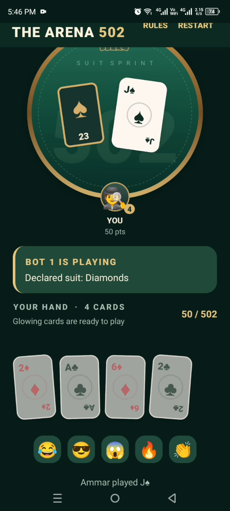
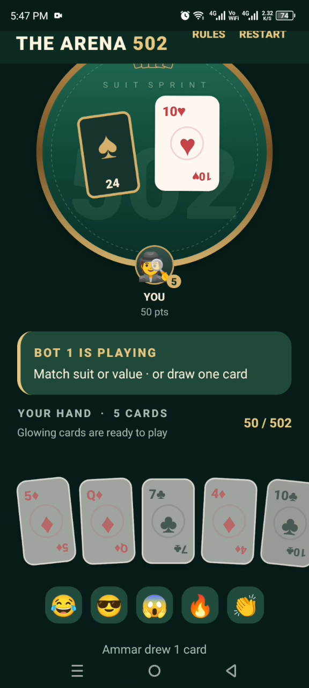
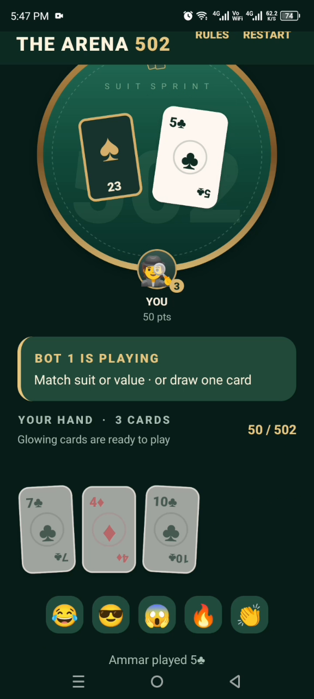
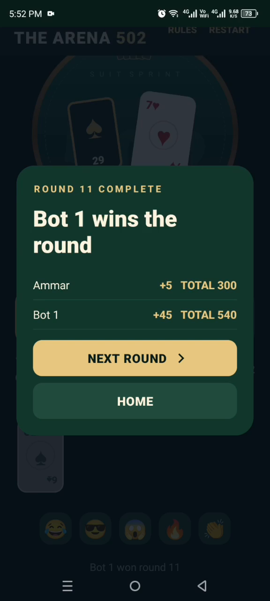
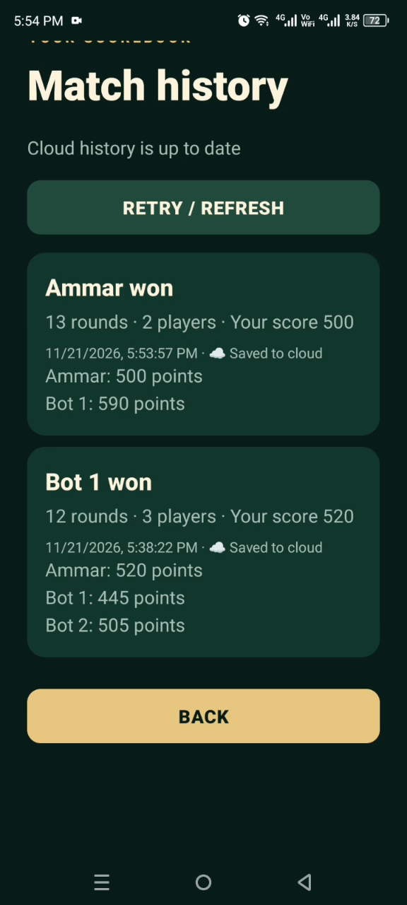

# Suit Sprint 502

An Expo / React Native solo adaptation of the **502** game on [SuitSaga Arena](https://502-game.vercel.app/). It uses an original emerald-club table interface and supports one human against one to five computer opponents. It does not include online rooms, voice or chat.

## Run

Prerequisites: Node.js 20.19+ and the Expo Go app or an Android emulator.

```bash
npm install
npm start
```

Copy `.env.example` to `.env.local` and fill in the Firebase web-app configuration before starting. The local environment file is ignored by Git. Then scan the Expo QR code with Expo Go, or press `a` in the Expo terminal for Android.

### Run in a browser

The web packages are included in `package.json`. Start web with:

```bash
npm run web
```

Web is useful for a quick check; the assessed mobile build should also be tested in Expo Go.

## Rules implemented

- Standard 52 card deck without jokers; seven cards per active player each round.
- Neutral opening card. The first round starts with the human. Later rounds start with the previous winner.
- Play a matching suit or rank, or draw one card and end the turn. Drawing is allowed even with a playable card.
- A Jack is wild and declares a suit. The 7♥ is wild and wins the round immediately.
- A 2 adds two cards to the next player's penalty; another 2 stacks it. A♠ starts a five card penalty; any other Ace can pass it on without increasing it. An 8 skips the next player; another 8 passes the skip on.
- During a pending penalty, only its response card can be played; otherwise the player takes the penalty. A final 2 or A♠ still forces the next player to draw before scoring, without a response chance.
- The draw pile is replenished by shuffling every discard except the top card.
- At round end, remaining cards score: 7♥ and A♠ = 100; 2, 8, Jack = 30; other Aces = 20; 10, Q, K = 10; remaining ranks = 5. A 7♥ winner also scores the cards they still hold.
- Players with 502 or more are eliminated after a round, except the round winner. The last active player wins the match.

Reference: [502 rules](https://502-game.vercel.app/rules). The app has an in-game rules screen as well.

## File map for the viva

| File | Purpose |
| --- | --- |
| `package.json` | Expo, React and React Native versions plus the mobile and web run commands. |
| `app.json` | Expo app name, identifier, orientation and theme. |
| `.env.example` | Safe placeholder names for the local Firebase configuration; it contains no project credentials. |
| `App.js` | All mobile screens: setup, table, rules, results, round summary and suit chooser. Uses `Animated` for the turn banner and a timer to take bot turns. |
| `src/game.js` | Pure game logic: deck, shuffle, legal moves, card effects, draw/recycle, scoring, elimination, round/match flow and bot decisions. |
| `src/ui/AnimatedCard.js` | Visual card entrance, fan angle and spring lift for playable cards. No rule decisions live here. |
| `src/ui/TurnClock.js` | Shows a 15 second clock; calls the screen when time expires. The screen then uses the normal draw/accept rule function. |
| `src/ui/ReactionBubble.js` | Short animated emoji speech bubble. The screen triggers it from game events. |
| `src/ui/RoundTable.js` | Emerald oval table, gold rail, player seats, detective avatar, turn rings, card backs, return banner and center-card motion. |
| `src/presentation/reactions.js` | Detects bot draw and penalty-return events for visual reactions. It never changes game rules. |
| `src/services/firebaseConfig.js` | Firebase project configuration shared by web and mobile. |
| `src/services/firebase.js` | Firebase web initialization. |
| `src/services/firebase.native.js` | Mobile initialization with persistent anonymous authentication. |
| `src/services/history.js` | Local-first result storage, anonymous authentication, Firestore upload and cloud query. |
| `src/services/useCloudHistory.js` | React state for History screen sync, retry and saving. |
| `.gitignore` | Keeps generated dependencies and Expo build files out of Git. |

### Key functions to explain

- `newMatch` builds the player list, then `beginRound` shuffles and deals.
- `playable` decides if a chosen card is legal, including pending penalties.
- `playCard` applies card effects and advances to the next active player.
- `drawOrAccept` handles ordinary drawing, accepting a draw penalty or accepting a skip.
- `finishRound` applies a final penalty before scoring, eliminates players at 502, and decides whether the match is over.
- `botMove` chooses among legal cards; the React screen calls it on a short timer when it is a bot's turn.

### Design and animation notes

The visual theme is a dark emerald private card club with an oval felt table, warm gold rail, ivory playing cards, seated avatars, hidden bot hands, pulsing turn rings, animated discard motion, a horizontal hand fan, glowing playable cards, a live clock and emoji reactions. These features are presentation only: `src/game.js` remains the source of truth for legal actions and scoring. When 15 seconds expire on the human turn, `TurnClock` calls `drawOrAccept`; this is an added solo-mode pacing rule. A bot reacts with 😤 after drawing four or more cards and 😂 when it passes an Ace penalty or stacked 2 back to the human. The human can tap an emoji reaction. Reactions do not affect gameplay.

## Firebase bonus

Completed matches are stored locally first and synchronized to Cloud Firestore under the current anonymous user's ID. The app works offline and clearly shows pending versus cloud-saved results. Anonymous Authentication and the Firestore security rules are configured in the Firebase project. The same Firebase JavaScript configuration works on Expo web, Android and iOS; separate native Firebase configuration files are unnecessary for this Expo Go implementation.

Research references used for interaction ideas, not copied UI: [Expo animation guidance](https://github.com/expo/skills/blob/main/plugins/expo/skills/expo-animation/SKILL.md) for spring timing and keeping motion scoped to UI; [Lexicon Expo card game](https://github.com/sbrshkappa/lexicon-app) for lifted playable cards; [animated card deck](https://github.com/neverjunior05/animated-playing-card-deck) for fan and deal motion. The app uses React Native's built-in `Animated` API and its own visuals.

## Demo sequence

1. Show `package.json` and explain the dependencies.
2. Start a match with one or more bots. Play a matching card and draw once.
3. Demonstrate a special card when dealt, the round summary and Next Round.
4. Show a completed match or use a longer prepared play session to demonstrate elimination and replay.
5. Show the Rules and History screens, then show the same result in Firebase Console.

## Screenshots and gameplay recording

| Animated card table | Bot gameplay and reactions |
| --- | --- |
|  |  |

| Special-card flow | Round result |
| --- | --- |
|  |  |

### Firebase history bonus



The full Android gameplay demonstration is included at [media/gameplay-demo.mp4](media/gameplay-demo.mp4). It shows the mobile UI, game flow, special cards, round and match endings, replay, and cloud-saved history.

## Submission status

The complete Expo source, screenshots, gameplay recording and Firebase integration are included in this repository. Bring the printed, completed evaluation rubric to the demo.
